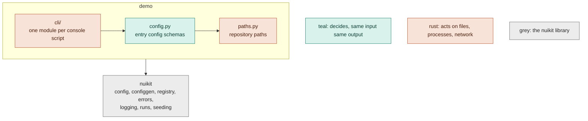

# Contributing

How demo is built and how to change it. Using it: [README.md](README.md). The general rules, with their reasons, are
in [nuinashco/conventions](https://github.com/nuinashco/conventions/blob/main/GUIDE.md); the shared machinery's in
[nuikit's guide](https://github.com/nuinashco/nuikit/blob/main/docs/guide.md).

## Architecture



Each seam keeps the two colours apart, so a dry run can execute the pure half for real. Domain packages go between
`config` and `paths`.

Dependencies point down: `cli` > `config` > `paths`, and any layer may import `nuikit`. The import-linter contract in
`pyproject.toml` enforces the order. It is exhaustive, so a new subpackage fails `make check` until it is placed in
`layers`.

## Repository layout

```text
configs/                  Hydra YAML; generated files say so in their first line
  run.yaml                entry config of demo-run: picks groups, holds this repo's choices
  defaults/run.yaml       every MainConfig setting with its default (generated)
  hydra/default.yaml      Hydra writes nothing; the app writes runs/
src/demo/
  cli/                    one module per console script: the composition roots
  config.py               entry config schemas + GENERATED (files `make configs` writes)
  paths.py                repository paths, from the .project-root marker
tests/                    mirrors src/ module by module
  test_invariants.py      configs compose and are fresh, kinds build, import layers hold
  integration/            end to end, `-m integration`
scripts/                  exploratory or one-time runnables, never imported
notebooks/                exploration only, outputs stripped; reference/ for third-party notebooks
runs/ data/               gitignored
```

## Extending

| to add | create | and |
|---|---|---|
| a family | `src/demo/<family>/base.py` + `items/` | place it in the import-linter `layers`; `make configs` |
| an item | `src/demo/<family>/items/<kind>.py` | `make configs` |
| an entry config | a schema in `config.py` listed in `GENERATED` as `defaults/<command>.yaml`, and `configs/<command>.yaml` composing it | a `cli/<command>.py` and a console script |
| a setting | a field with a default on the schema, described only if its name leaves something open (DOC-7) | `make configs` |

## Deviations

None.

## Tests

```bash
make test               # unit tests, a few seconds
make test-integration   # end to end, behind the integration marker
```

Fakes, not mocks (`unittest.mock` is banned by ruff). Each case covers a distinct behaviour; child processes and
servers only for what cannot be measured in process.

## Commits

Conventional Commits with the standard types (`feat fix docs refactor test build ci perf style chore revert`), an
optional scope, a lowercase imperative subject: one line, no articles, no body or trailers. Short-lived `<type>/<slug>`
branches, squash-merged. The commit-msg hooks check all of it. PR descriptions follow
`.github/pull_request_template.md`; `make github`, run once per repo, makes the squash commit the PR title alone.
